<div align="center">

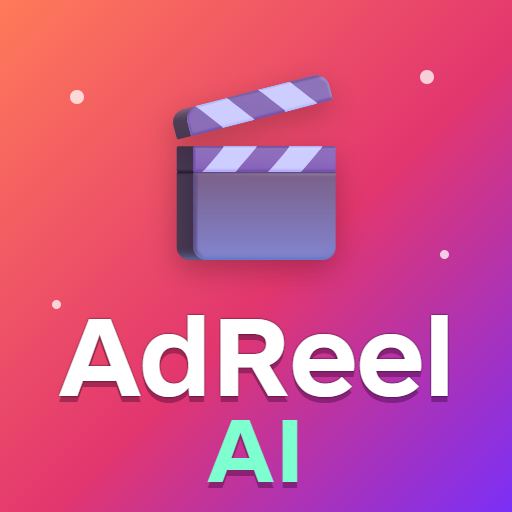

# AdReel

**Telegram-бот, который из ссылки на товар и пары слов собирает рекламный AI-ролик до 30 секунд<br>для TikTok, Reels и Shorts: сценарий, видео по сценам, озвучка, музыка в такт и монтаж.**


<br>


</div>

---

<div align="center">
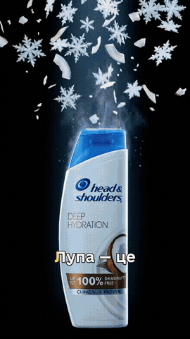
<br><sub>Этот ролик собрал AdReel: сцены сняла видеомодель, озвучку, караоке-субтитры<br>
и монтаж сделал сам бот. Товарный знак принадлежит владельцу, ролик — демонстрация.</sub>
</div>

<br>

Нейросети снимают клипы по 5–10 секунд, а реклама — это сценарий, хук в первые две
секунды, голос, который влезает по времени, музыка, под которую режутся сцены, и
финальная карточка с ценой. AdReel делает всё это в чате с ботом: кидаешь ссылку на
товар, отвечаешь на пару вопросов, выбираешь идею — и получаешь готовый вертикальный
MP4 1080×1920.

Деньги тратятся только в конце. До этого бот показывает карточку товара, сценарий по
сценам, озвучку и кусок трека, и всё можно поправить словами.

## ✨ Что умеет

- 📦 **Разбирает товар сам.** Ссылка на магазин (JSON-LD, OpenGraph, текст страницы),
  фото, видео с YouTube, голосовые. LLM со зрением собирает карточку, у каждого факта
  есть источник, а спрашивает бот только то, чего не хватает.
- 🎭 **Четыре агента вместо одного промпта.** Креативщик предлагает направления, режиссёр
  пишет сценарий по сценам под лимиты видеомодели, копирайтер — озвучку, которая влезает
  по времени, оператор — промпты под конкретную модель и непрерывность сцен.
- ✅ **Правила держит код, а не надежда на промпт.** Длительности, хук до 3 секунд, лимит
  символов озвучки, сцены с реальным фото. Ответ не прошёл проверку — модель переделывает
  его со списком ошибок.
- 🧾 **Факты только из карточки.** Каждое утверждение диктора привязано к источнику.
  «Лучший», «№1» и «100%» без подтверждения не пройдут, медицинских обещаний не будет.
- 🎵 **Слышит музыку.** Темп, сильные доли, дропы. Дроп ложится на главный кадр, склейки
  в такт, а кусок трека можно назвать словами: «припев», «0:42–1:02».
- 📚 **Библиотека треков.** Свои треки сохраняются, переименовываются и удаляются, трек
  с YouTube сразу получает название ролика.
- 🎬 **Видео по сценам на fal.ai.** Стартовый кадр с реальным товаром → image-to-video.
  Сцена может продолжить предыдущую с её последнего кадра, соседние сцены снимаются одной
  генерацией (дешевле и без шва), палитра всего ролика тянется к первому кадру.
- 🎙 **Звук главный.** Озвучка ElevenLabs с таймингами слов, клипы режутся под голос.
  Караоке-субтитры, надписи сцен, музыка тише голоса и приседает под ним, громкость −14 LUFS.
- 💸 **Деньги под контролем.** Оценка перед запуском, учёт себестоимости по каждому вызову,
  защита от двойной оплаты (подробно — ниже).
- 🔒 **Личный бот.** Пускает только владельца, ссылки из чужих сообщений не достанут
  внутреннюю сеть.

## 📱 Как это выглядит в Telegram

Тексты и кнопки — настоящий вывод [`bot/view.py`](adreel/bot/view.py), озвучка — дословно
из ролика выше. Сами экраны — макеты, собранные скриптом
[`scripts/readme_assets.py`](scripts/readme_assets.py), а не скриншоты переписки.

<table>
<tr>
<td width="55%">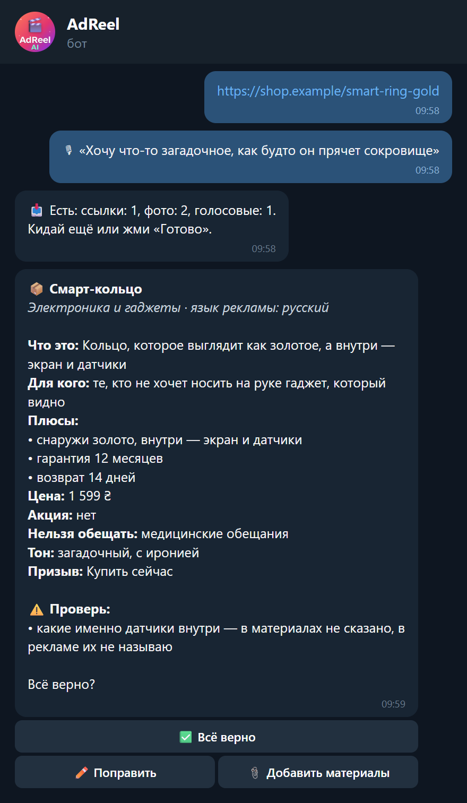</td>
<td>

### 📦 Карточка товара

Кидаешь ссылку и пару слов. Бот сам вытаскивает название, цену и плюсы, раскладывает
по полям и помечает, что надо проверить: тут цена с оговоркой из мелкого шрифта.

Не хватает данных — задаст 5–8 вопросов, где можно — кнопками. Карточка сохраняется,
в следующий раз товар выбирается из списка.

</td>
</tr>
<tr>
<td>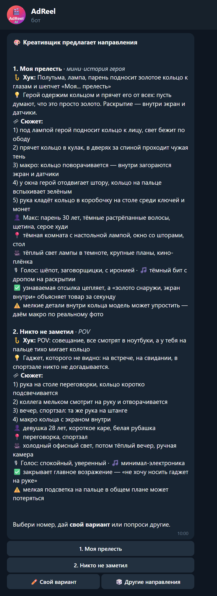</td>
<td>

### 🎨 Направления

Креативщик предлагает разные идеи: формат, хук, визуал, голос, музыку и честные риски
для видеомодели.

Можно выбрать номер, попросить другие или надиктовать свою идею — креативщик доведёт
её до направления, не подменяя замысел.

</td>
</tr>
<tr>
<td>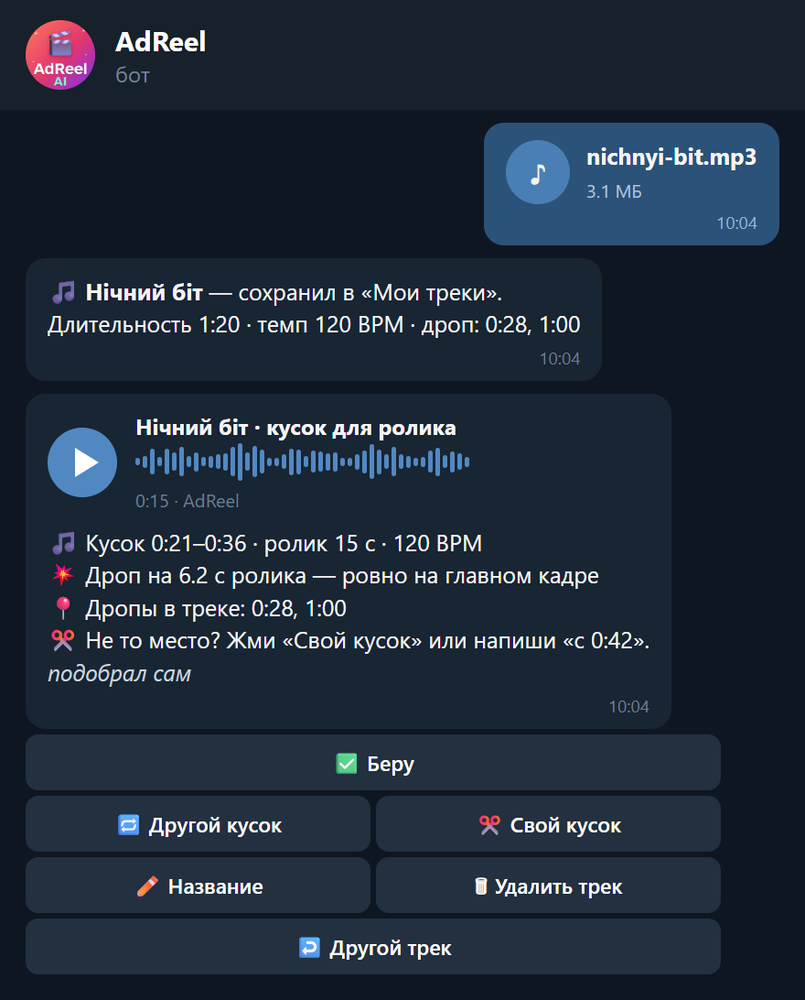</td>
<td>

### 🎵 Музыка

Свой трек файлом или ссылкой на YouTube. Бот разбирает ритм и присылает послушать
ровно тот кусок, что пойдёт в ролик, и объясняет выбор: куда попал дроп.

Не то место — «Другой кусок» или словами «с 0:42». Трек можно переименовать или удалить
прямо здесь.

</td>
</tr>
<tr>
<td>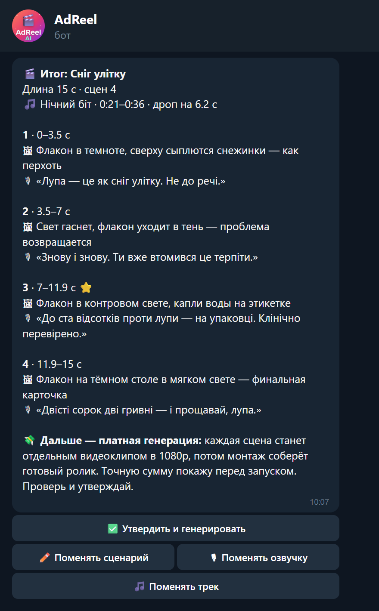</td>
<td>

### ✅ Итог перед оплатой

Сценарий, озвучка и трек одним сообщением: что видно в каждой сцене и что говорит диктор.

Это последняя точка, где всё бесплатно. Любую часть можно поменять, а «Утвердить»
запускает платную генерацию.

</td>
</tr>
<tr>
<td>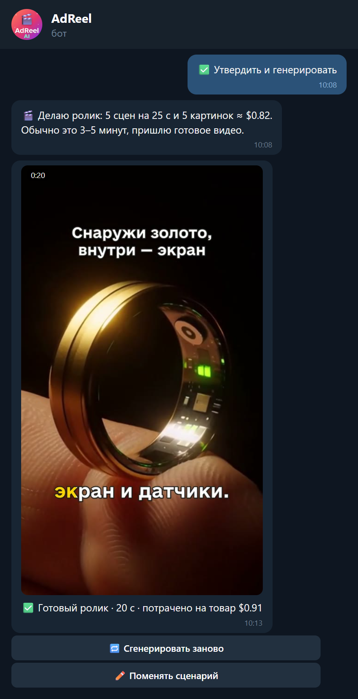</td>
<td>

### 🎬 Готовый ролик

Перед стартом — оценка в долларах по реальным ценам модели. Куски бот не шлёт: в чат
приходит один смонтированный ролик и сколько ушло на товар.

Если генерация упала, кнопка «Доделать» продолжит с места сбоя и не заплатит за готовые
сцены второй раз.

</td>
</tr>
</table>

## 🎵 Музыка в такт

<div align="center">
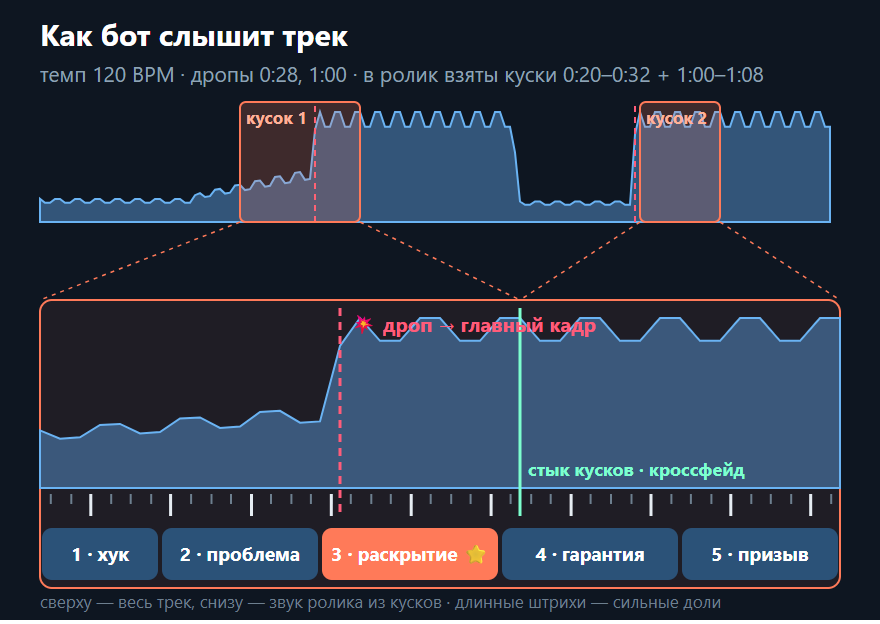
<br><sub>Настоящий разбор <code>music/analyze.py</code> на синтетическом треке</sub>
</div>

<br>

- **Разбор один раз при загрузке.** Темп по медиане интервалов между битами (оценка
  librosa на ровных 120 BPM давала 117.5), сильные доли, дропы — скачок громкости.
- **Кусок под сценарий.** Длина куска равна длине ролика, а дроп попадает на главный кадр
  ±1 секунда. Начало куска стоит на сильной доле, поэтому звук стартует в такт.
- **Словами тоже можно.** «0:42–1:02», «с 30-й секунды на 20», «припев», «вступление»,
  «весь трек». Короткий трек пойдёт по кругу.
- **На монтаже** музыка на −14 dB, приседает под голосом (sidechaincompress), итог
  нормализуется до −14 LUFS, как просят площадки.

## 🎬 Монтаж

<div align="center">
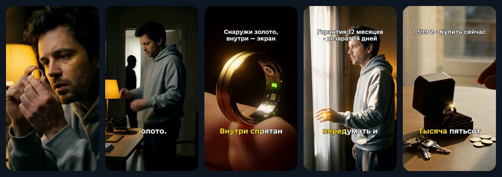
<br><sub>По кадру на каждую сцену ролика выше</sub>
</div>

<br>

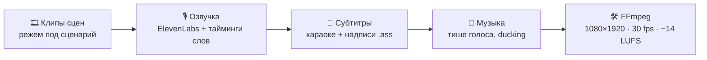

- **Звук главный.** Клипы генерируются не короче сцены и режутся под озвучку. Сегмент
  сцены всегда ровно своей длины, поэтому голос не уезжает на стыках.
- **Субтитры как в вирусных роликах.** Один кегль на весь ролик, слово подсвечивается
  в такт голосу, строка не переходит через конец фразы.
- **Надписи делаем мы, а не нейросеть.** У видеомоделей буквы плывут, поэтому надпись
  сцены и цену рисует libass поверх видео.
- **Непрерывность.** Продолжающая сцена стартует с последнего кадра предыдущей,
  цвет тянется к первому кадру ролика, первые кадры на стыке выбрасываются.

## 💸 Деньги под контролем

Каждый клип стоит денег, поэтому защита от лишних трат собрана в коде, а не в надежде
на аккуратность:

| Что | Как |
|---|---|
| **Оценка до старта** | Сумма по ценам из `config/video_models.yaml`, только за то, что ещё не снято |
| **Повтор не платит дважды** | ID запроса к fal пишется на диск сразу после отправки и стирается только после скачивания результата. Повтор подбирает уже оплаченное |
| **«Доделать» после сбоя** | Готовые сцены пропускаются, оплаченный стартовый кадр берётся из БД |
| **Двойной тап** | Второй запуск того же ролика отклоняется, состояние ставится до первого `await` |
| **Учёт** | Каждый платный вызов (LLM, картинка, видео, голос) пишет событие в `cost_events` |
| **Черновой режим** | `VIDEO_MODEL=h3-max-turbo-480` — ролик 20 с за ~$0.67 для обкатки промптов |

## ⚙️ Как это работает

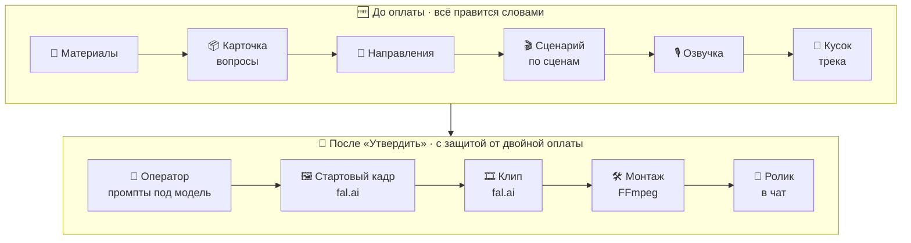

Бот — тонкая оболочка: вся логика в сервисах, у каждого внешнего API есть интерфейс
и подделка для тестов.

| Сервис | Что делает |
|---|---|
| **`ProductService`** | Материалы, разбор страниц и фото, карточка, вопросы, правки словами |
| **`ScriptService`** | Агенты креатива: направления, сценарий, озвучка, план оператора. Опционально — выжимка по рынку через Tavily |
| **`MusicService`** | Библиотека треков, разбор ритма, выбор куска, превью |
| **`GenerationService`** | Оценка, генерация сцен по очереди, монтаж готового ролика |

## 🚀 Быстрый старт

### Windows, двойным кликом

`run_bot.bat` проверит uv, ffmpeg и `.env` (нет — создаст из примера и откроет в блокноте),
запустит бота и перезапустит его, если тот упадёт.

### В Docker (бот + локальный Bot API без лимита 20 МБ на файлы)

```bash
git clone https://github.com/TimurPythonUser/adreel.git
cd adreel

cp .env.example .env        # впиши ключи, см. ниже
docker compose up -d --build
docker compose logs -f bot
```

Перед первым запуском отвяжи бота от облачного API — подробности в шапке
[`docker-compose.yml`](docker-compose.yml).

### Вручную

```bash
uv sync
uv run python -m adreel.bot   # в логе видно, каких ключей не хватает
```

Свой `OWNER_TELEGRAM_ID` узнаешь командой **/id** в боте. Дальше: /help — инструкция,
/new — новый ролик.

## 🔑 Настройки

Полный список с комментариями — в [`.env.example`](.env.example). Главное:

| Переменная | Зачем | По умолчанию |
|---|---|---|
| `TELEGRAM_BOT_TOKEN` | бот от @BotFather | — |
| `OWNER_TELEGRAM_ID` | единственный, кого бот пускает | — |
| `FAL_KEY` | картинки и видео на fal.ai | — |
| `ELEVENLABS_API_KEY` / `ELEVENLABS_VOICE_ID` | озвучка с таймингами слов | — |
| `ANTHROPIC_API_KEY` / `DEEPSEEK_API_KEY` | LLM: что начинается с `deepseek`, идёт в DeepSeek | — |
| `TEXT_MODEL` / `VISION_MODEL` | разбор материалов и фото | `deepseek-flash` / `claude-haiku-4-5` |
| `CREATIVE_MODEL` | креативщик, сценарий, озвучка; пусто = `TEXT_MODEL` | — |
| `VIDEO_MODEL` | ключ из `config/video_models.yaml` | H3 Max Turbo, 1080p |
| `TAVILY_API_KEY` | поиск по рынку для креативщика, пусто = без поиска | — |
| `TELEGRAM_API_ID` / `TELEGRAM_API_HASH` | локальный Bot API в Docker | — |

Цены — только в `config/pricing.yaml` и `config/video_models.yaml`, модели — в `.env`
и `config/`. Сменить видеомодель = поменять одну строку.

## 🧰 Стек

| Задача | Чем |
|---|---|
| Бот | aiogram 3, FSM, локальный Telegram Bot API |
| Тексты: карточка, креатив, сценарий, озвучка | Claude (`messages.parse`), DeepSeek (JSON + переспрос) |
| Картинки и видео | fal.ai: очередь, опрос, защита от двойной оплаты |
| Голос | ElevenLabs с таймингами слов и проверкой обрывов |
| Ритм музыки | librosa, декодирование через ffmpeg |
| Страницы и видео | trafilatura, lxml, yt-dlp |
| Монтаж | FFmpeg, ASS-субтитры (libass), sidechaincompress, loudnorm |
| Данные | SQLAlchemy 2 + Alembic на SQLite (Postgres — сменить URL) |
| Проверки | pytest, ruff, mypy; платные API в тестах не вызываются |

## 🧪 Проверки

```bash
uv run pytest                              # 161 тест, без платных API
uv run ruff check .
uv run mypy adreel
RUN_LIVE_TESTS=1 uv run pytest -m live     # живые вызовы fal и ElevenLabs, стоят денег
```

## 📁 Структура

```
adreel/
├── bot/            # Telegram: товар, креатив, музыка, итог и генерация
├── product/        # карточка товара, вопросы, сборка карточки LLM
├── ingest/         # страницы, картинки, видео (yt-dlp), голосовые, хранилище файлов
├── script/         # агенты креатива, правила, оператор, плейбук
├── research/       # поиск и выжимка по рынку (Tavily)
├── music/          # разбор ритма, кусок словами, библиотека
├── gen/            # fal.ai, защита от двойной оплаты, генерация сцен
├── render/         # ffmpeg, ASS-субтитры, монтаж
├── llm/  tts/      # Claude, DeepSeek, ElevenLabs + подделки для тестов
├── db/             # модели и миграции
└── costs.py        # себестоимость по каждому вызову
config/             # модели, цены, категории, плейбук
prompts/            # промпты с версиями
scripts/            # картинки для этого README
docs/               # план, решения, картинки
run_bot.bat         # запуск двойным кликом
```

План по этапам — [docs/PLAN.md](docs/PLAN.md), принятые решения и уроки —
[docs/DECISIONS.md](docs/DECISIONS.md), памятка по коду — [CLAUDE.md](CLAUDE.md).

---

<div align="center">

Ссылка на товар → готовый рекламный ролик, не выходя из Telegram 🎬

</div>
